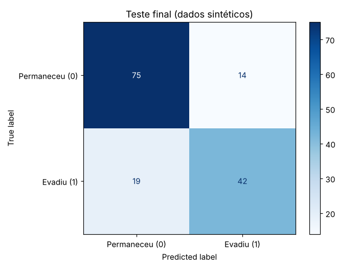
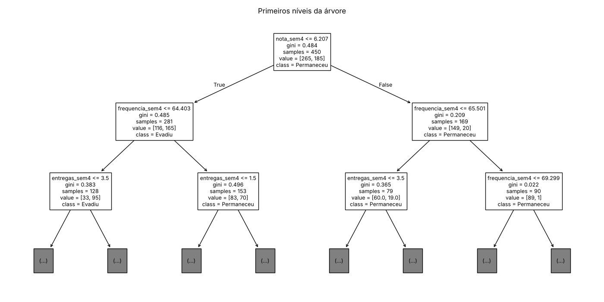
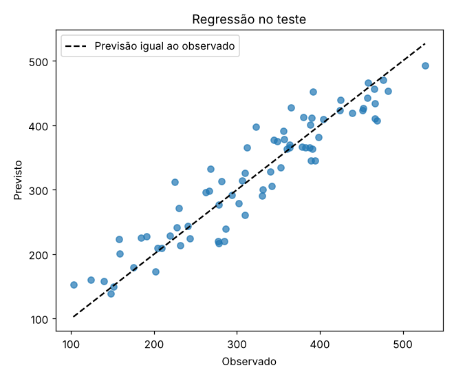
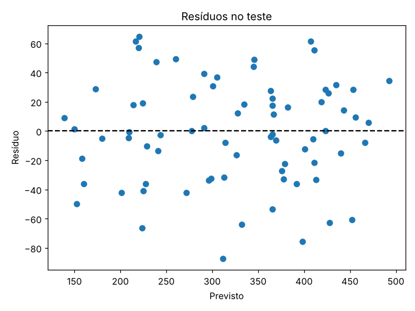

**Profa. Kadidja Valéria | UDF**  
Ciência de Dados e Aprendizado de Máquina · Sistemas de Informação · 2026.2

# Aula 2 — Registro do laboratório supervisionado

## Identificação

- Estudante ou equipe: **Kauane Braga dos Santos Silva de Sousa e Isabella Ana Dutra de Sousa**
- Turma: **Sistemas de Informação — Noturno — Quarta-feira**
- Data de realização: **16/10/2026**
- Integrantes e contribuições (se em equipe): **Kauane — execução do notebook, experimentos e experimento do MVC Finance; Isabella — PBLs, revisão das respostas e conferência dos links e arquivos. Ambas revisaram o conteúdo completo.**

## Percurso escolhido

- [x] Python/Colab ou Jupyter.
- [ ] Orange Data Mining.

Use o [notebook de apoio](notebooks/laboratorio.ipynb) ou o [CSV sintético](dados/educacionais-sinteticos.csv). O CSV contém 600 registros fictícios. Atributos: `frequencia_sem4`, `nota_sem4`, `entregas_sem4`. Alvo: `evasao_fim_semestre` (0 permaneceu, 1 evadiu). As associações foram definidas pela simulação, sem validade empírica sobre estudantes reais.

## 1. Ambiente e reprodução

| Item | Registro |
| --- | --- |
| Ambiente e data | Jupyter (kernel Python 3), Linux, 16/10/2026 |
| Versões das ferramentas/bibliotecas | Python 3.13.16; NumPy 2.5.3; pandas 3.0.5; matplotlib 3.11.2; scikit-learn 1.9.1 |
| Semente aleatória | 42 (`SEMENTE = 42`, usada na simulação, na divisão, na validação cruzada e na árvore) |
| Caminho do notebook executado ou fluxo Orange | [notebooks/laboratorio-equipe.ipynb](notebooks/laboratorio-equipe.ipynb) e resultados em [notebooks/resultados_execucao.json](notebooks/resultados_execucao.json) |
| Origem dos dados e condição sintética | Dados gerados pela simulação do próprio notebook (idênticos ao CSV fornecido). Totalmente sintéticos, sem estudantes reais. |

## 2. Problema e preparação

- Pergunta de negócio: **Quais estudantes poderiam receber um convite voluntário de apoio antes do fim do semestre, com base nos sinais observados até a semana 4?**
- Unidade de análise e horizonte: **Um estudante fictício; previsão feita ao fim da semana 4 para o desfecho no fim do semestre.**
- Atributos disponíveis no instante da previsão: **`frequencia_sem4` (%), `nota_sem4` (0–10), `entregas_sem4` (quantidade, 0–8).**
- Variável-alvo e sua natureza: **`evasao_fim_semestre`, categórica binária (0 = permaneceu, 1 = evadiu). Distribuição: 59,0% classe 0 e 41,0% classe 1.**
- Ausências e outros problemas encontrados: **30 valores ausentes (5%) em `nota_sem4`; demais colunas completas. Não há identificadores. O alvo tem ruído (é sorteado a partir de uma probabilidade).**
- Tratamentos e conjunto usado para aprendê-los: **Imputação pela mediana (`SimpleImputer`) dentro de um `Pipeline`, aprendida apenas no treino (em cada dobra da validação cruzada, apenas na parte de treino da dobra). Árvore não exige padronização.**

## 3. Desenvolvimento e teste

- Método de divisão e justificativa: **Holdout aleatório estratificado (`train_test_split`, `test_size=0.25`, `stratify=y`). É adequado porque os registros simulados são independentes; estratificar mantém a proporção de evasão nos dois conjuntos.**
- Quantidades de treino e teste: **Treino: 450 registros; teste: 150 registros.**
- Procedimento de validação no treino: **Validação cruzada estratificada em 5 partes (`StratifiedKFold`, `shuffle=True`, `random_state=42`) sobre os 450 registros de treino.**
- Parâmetros da árvore e como foram escolhidos: **`max_depth` ∈ {2, 3, 5, None} com `min_samples_leaf=10`; escolhida a maior acurácia média de validação: `max_depth=5`, `min_samples_leaf=10`.**
- Como o teste ficou fora da seleção: **O conjunto de teste só foi usado uma vez, após a escolha e o ajuste final do pipeline no treino completo. Imputação e escolha de parâmetros não viram o teste.**

### Alternativa Orange

Confira o alvo como categórico. Registre as conexões: File/Select Columns → Test & Score (Data), Tree → Test & Score (Learner), Test & Score → Confusion Matrix (Evaluation Results). Data Table permite inspeção. Se usar Preprocess, conecte o preprocessor ao learner para ajustar transformações dentro do treino. Não use apenas `Test on train data` como avaliação final.

**Fluxo e método de avaliação realmente utilizados:** Não se aplica — foi usado o percurso Python/Jupyter (holdout estratificado 75/25 + validação cruzada estratificada de 5 partes no treino).

Se comparar configurações, use validação no treino e reserve teste independente. Documente em Test & Score as entradas Data e Test Data, quando utilizadas.

## 4. Resultados calculados de classificação

| Modelo | Configuração | Acurácia de treino | Acurácia de validação e dispersão | Acurácia de teste |
| --- | --- | --- | --- | --- |
| Referência | `DummyClassifier(strategy='most_frequent')` — sempre prevê 0 | 0,5889 | 0,5889 ± 0,0000 (VC 5 partes) | 0,5933 |
| Árvore final | Imputação mediana + `DecisionTreeClassifier(max_depth=5, min_samples_leaf=10, random_state=42)` | 0,8133 (treino completo); 0,8111 média VC | 0,7222 ± 0,0391 | 0,7800 |

**Matriz: linhas reais e colunas previstas; classe positiva = 1.** ([imagem](assets/matriz-confusao.png))

| Real / previsto | Permaneceu (0) | Evadiu (1) |
| --- | --- | --- |
| Permaneceu (0) | 75 (TN) | 14 (FP) |
| Evadiu (1) | 19 (FN) | 42 (TP) |

- Acurácia calculada manualmente pela matriz: **(TN + TP) / total = (75 + 42) / 150 = 117 / 150 = 0,78.**
- Sensibilidade da classe 1: **TP / (TP + FN) = 42 / (42 + 19) = 42 / 61 ≈ 0,689 (68,9%).**
- Comparação com referência: **A árvore acerta 0,78 contra 0,593 da referência (+18,7 pontos percentuais). A referência nunca identifica evasão (sensibilidade 0), enquanto a árvore identifica cerca de 69% dos casos de evasão do teste.**
- Consequências dos falsos positivos: **14 estudantes que permaneceriam seriam sinalizados: contato de apoio desnecessário, possível desconforto ou sensação de rotulação e uso de tempo da equipe. Como a ação é voluntária e acolhedora, o custo é relativamente baixo.**
- Consequências dos falsos negativos: **19 estudantes que evadiram não seriam sinalizados e poderiam ficar sem convite de apoio. É o erro mais preocupante neste contexto, por isso o apoio deve continuar aberto a todos, não só aos sinalizados.**
- Interpretação do gráfico e da árvore: **A primeira pergunta da árvore é `nota_sem4 ≤ 6,21`; nos dois ramos, a pergunta seguinte é sobre `frequencia_sem4` (limites ≈ 64,4% e 65,5%). Importância dos atributos: nota 0,62, frequência 0,24, entregas 0,14. Isso indica que, nesta simulação, nota baixa combinada com baixa frequência concentra os casos de evasão. É uma associação criada pela simulação, não uma relação causal ([árvore](assets/arvore.png)).**

## 5. Experimentos no treino

Compare parâmetros usando apenas treino/validação. Após conhecer o teste, uma nova seleção exige novo teste independente para avaliação final.

| Experimento | Alteração | Resultado de validação | Interpretação |
| --- | --- | --- | --- |
| 1 | `min_samples_leaf` = 5, 20 e 40 (com `max_depth` 2, 3, 5, None) | Melhores médias: leaf 5 → 0,7222 ± 0,0298 (prof. 5); leaf 20 → 0,7267 ± 0,0480 (prof. 5/None); leaf 40 → 0,7289 ± 0,0303 (prof. 5/None). Com leaf 5 e prof. None, treino 0,8678 vs validação 0,7133. | Folhas maiores reduzem a distância treino–validação (menos sobreajuste). As diferenças de validação (≈0,72–0,73) são menores que o desvio-padrão (~0,03–0,05), então não há superioridade clara. Como este experimento foi feito depois de conhecer o teste, o modelo final permanece prof. 5/leaf 10; adotar leaf 40 exigiria um novo teste independente. |
| 2 | Remover um atributo (árvore prof. 5, leaf 10) | Sem frequência: 0,7156 ± 0,0362; sem nota: 0,6289 ± 0,0475; sem entregas: 0,7022 ± 0,0310 (com os três: 0,7222). | Retirar a nota derruba mais o desempenho, ou seja, ela é o atributo mais informativo para prever nesta simulação. Isso mostra utilidade preditiva, não causa. |

Responda:

1. Como a profundidade e o tamanho das folhas podem afetar o sobreajuste? **Árvores muito profundas e com folhas pequenas conseguem criar regras específicas para poucos registros, decorando ruído do treino: a acurácia de treino sobe e a de validação para de melhorar ou cai (ex.: leaf 5, prof. None: 0,868 treino vs 0,713 validação). Limitar a profundidade e exigir folhas maiores simplifica o modelo e tende a reduzir o sobreajuste; restringir demais causa subajuste (prof. 2: 0,733 treino e 0,684 validação).**
2. Retirar um atributo e observar mudança no desempenho prova causalidade? **Não. Mostra apenas que o atributo contém informação útil para prever, dado os outros atributos e este conjunto de dados. O atributo pode estar correlacionado com a verdadeira causa (ex.: trabalho, saúde, renda), e atributos correlacionados podem se substituir. Causalidade exigiria desenho experimental ou métodos causais específicos.**
3. Se 95% permanecem, o que acontece com um modelo que sempre prevê permanência? **Ele teria 95% de acurácia sem identificar nenhum caso de evasão: na matriz, TP = 0 e todos os evadidos seriam FN; sensibilidade = 0. Por isso a acurácia sozinha engana em classes desbalanceadas, e é preciso olhar a matriz, a sensibilidade e comparar com essa referência.**

## 6. Regressão — seção independente

Execute a seção da biblioteca no notebook ou registre o procedimento equivalente em Orange. Dados também sintéticos. Alvo numérico: empréstimos por semana.

| Item | Registro |
| --- | --- |
| Atributos e alvo | Atributos: `usuarios_ativos` (100–1000) e `horas_abertura` (20–60 h/semana). Alvo: `emprestimos_semana` (numérico). 300 semanas sintéticas. |
| Divisão e preparação | Holdout aleatório 75/25 (225 treino, 75 teste), `random_state=42`; imputação mediana no pipeline (não havia ausentes) e `LinearRegression`. Coeficientes: 0,348 por usuário ativo e 2,297 por hora de abertura; intercepto 37,3. |
| MAE do modelo e unidade | 28,59 empréstimos por semana |
| MAE da referência | 84,73 empréstimos por semana (`DummyRegressor` com a média do treino) |
| R² do teste | 0,8774 |
| Interpretação do gráfico observado/previsto | Os pontos ficam próximos da diagonal "previsão = observado" em toda a faixa, sem curvatura visível: o modelo linear captura bem a tendência ([imagem](assets/regressao-observado-previsto.png)). A dispersão em torno da linha corresponde ao ruído da simulação. |
| Interpretação dos resíduos | Resíduos espalhados em torno de zero (média −1,28; desvio ≈ 35,5; entre −87 e +65), sem padrão claro em função do valor previsto, compatível com o ruído normal (σ = 35) usado na simulação ([imagem](assets/regressao-residuos.png)). Alguns erros individuais passam de 40 empréstimos, então a previsão serve para planejamento, não como valor exato. |
| Limitação de extrapolação | O modelo só foi visto em 100–1000 usuários e 20–60 horas. Prever para 10.000 usuários ou 100 horas assume que a relação linear continua igual, o que não foi observado (pode haver saturação, limite de acervo etc.). Também não considera sazonalidade nem ordem temporal. |

Explique por que R² não é porcentagem de acertos: **R² = 1 − (soma dos erros quadráticos do modelo / soma dos erros quadráticos de prever sempre a média do conjunto avaliado). Ele mede quanto o modelo reduz o erro em relação a essa referência, não quantas previsões "acertaram" — em regressão quase nenhuma previsão é exatamente igual ao real. R² = 0,877 significa que o erro quadrático ficou cerca de 88% menor que o da média, não que 88% das semanas foram acertadas. Ele pode até ser negativo, quando o modelo é pior que a média.**

## 7. Evidências e conclusão

- Link relativo do notebook/fluxo: **[notebooks/laboratorio-equipe.ipynb](notebooks/laboratorio-equipe.ipynb)**
- Links das imagens, se houver: **[assets/matriz-confusao.png](assets/matriz-confusao.png), [assets/arvore.png](assets/arvore.png), [assets/regressao-observado-previsto.png](assets/regressao-observado-previsto.png), [assets/regressao-residuos.png](assets/regressao-residuos.png)**
- Principal aprendizado: **Separar o teste antes de qualquer ajuste (inclusive a imputação) e escolher parâmetros só com validação no treino; e sempre comparar com uma referência simples e olhar a matriz de confusão, não só a acurácia.**
- Limitações de generalização e vieses possíveis: **Os dados são sintéticos e as associações foram escolhidas pela simulação; há apenas uma divisão de teste (150 registros), então a acurácia 0,78 tem incerteza; não há grupos reais (curso, turno, renda) para avaliar equidade; em dados reais seria preciso divisão temporal (turmas futuras).**
- Cuidados com privacidade e uso responsável: **Não usar identificadores; minimizar dados; acesso restrito; usar o resultado só para oferecer apoio voluntário com revisão humana, nunca para punir ou tomar decisões automáticas.**

[Voltar ao início](README.md).
