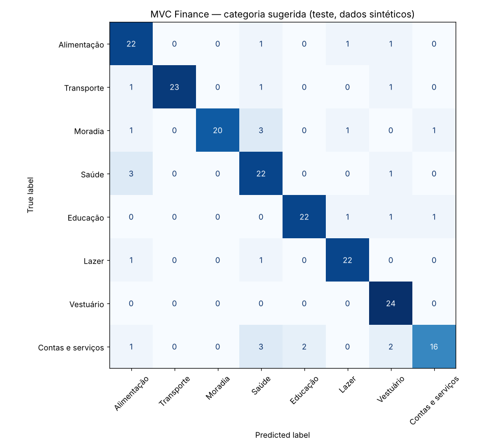

**Profa. Kadidja Valéria | UDF**  
Ciência de Dados e Aprendizado de Máquina · Sistemas de Informação · 2026.2

# Aplicação ao nosso TCC — MVC Finance

## Identificação

- Estudante ou equipe: **Kauane Braga dos Santos Silva de Sousa e Isabella Ana Dutra de Sousa**
- Turma: **Sistemas de Informação — Noturno — Quarta-feira**
- Data de realização: **16/10/2026**
- Integrantes e contribuições: **Kauane: notebook e experimento. Isabella: formulação do problema, limites e privacidade. Ambas revisaram tudo.**

## 1. O sistema

O **MVC Finance** é o nosso TCC (UDF, 2026, com Jhonathan de Moura Santos). É uma aplicação web SaaS de gestão financeira pessoal (Next.js, TypeScript, PostgreSQL/Prisma, Clerk, Stripe) que junta:

- **módulo financeiro:** o usuário registra depósitos, despesas e investimentos com título, valor, tipo, uma das **28 categorias**, método de pagamento e data, e acompanha um dashboard mensal;
- **módulo educacional:** seis cursos em três níveis, com lições, questionários, XP e conquistas;
- **relatório de IA** (Plano Premium): o GPT-4o-mini recebe só data, valor, tipo e categoria das operações do mês e devolve uma análise.

O relatório usa **IA generativa pronta**. O sistema não tem nenhum modelo de **aprendizado de máquina treinado com os próprios dados**. Esta atividade investiga onde isso faria sentido.

## 2. Problema escolhido

O TCC registra como limitação que **o registro das transações é manual**, o que, segundo a introdução, dificulta o uso contínuo. Escolher a categoria certa entre 28 opções é uma parte desse esforço.

- **Pergunta de negócio:** é possível **sugerir automaticamente a categoria** de uma despesa a partir do título que o usuário digita, para reduzir cliques e erros de cadastro?
- **Decisão apoiada:** pré-selecionar uma categoria no modal "Adicionar Transação". O usuário sempre confirma ou troca.
- **Unidade de análise:** uma transação do tipo Despesa.
- **Atributo:** `titulo` (texto livre), conhecido no momento em que o usuário digita.
- **Alvo:** `categoria`. Neste experimento são 8 categorias de despesa, um subconjunto didático das 15 do sistema.
- **Tipo de tarefa:** classificação supervisionada multiclasse. As transações já registradas trazem a categoria escolhida pelo usuário, que funciona como rótulo.

## 3. Dados

| Item | Registro |
| --- | --- |
| Origem | **Sintética**, gerada no notebook pelo sorteio de palavras típicas de cada categoria ("mercado", "uber", "aluguel", "farmácia"...). **Nenhum dado de usuário real do MVC Finance foi usado.** |
| Tamanho | 800 transações, cerca de 100 por categoria ([CSV](dados/mvc_finance_transacoes_sinteticas.csv)) |
| Ruído simulado | 15% dos títulos com prefixo genérico ("pix mercado"), 8% totalmente genéricos ("pix", "compra") e 10% dos rótulos trocados ao acaso, para imitar erro de cadastro |
| Por que não usar dados reais | O TCC não afirma conformidade integral com a LGPD. Usar títulos reais exigiria consentimento, base legal e política de retenção. |

## 4. Método

| Item | Registro |
| --- | --- |
| Ambiente | Jupyter, Python 3.13.16, scikit-learn 1.9.1, pandas 3.0.5, NumPy 2.5.3. Semente 42. |
| Notebook | [notebooks/mvc-finance-categoria.ipynb](notebooks/mvc-finance-categoria.ipynb) (executado). Resultados em [resultados_mvc_finance.json](notebooks/resultados_mvc_finance.json). |
| Divisão | Holdout estratificado 75/25: 600 para treino e 200 para teste |
| Preparação | TF-IDF de n-gramas de caracteres (2 a 4) **dentro do Pipeline**, aprendido só no treino. Os n-gramas de caracteres toleram erros de digitação e falta de acento ("farmacia"). |
| Modelo | Regressão logística multiclasse |
| Seleção | `C` ∈ {0,1; 1; 10}, escolhido por validação cruzada estratificada em 5 partes, só no treino. O teste foi usado uma única vez. |
| Referência | `DummyClassifier`, que sempre prevê a categoria mais frequente |

## 5. Resultados calculados

**Validação cruzada (treino):**

| Modelo | Acurácia de treino | Acurácia de validação ± desvio | F1 macro de validação |
| --- | --- | --- | --- |
| Referência (mais frequente) | — | 0,1317 ± 0,0033 | 0,0291 |
| TF-IDF + LogReg, C = 0,1 | 0,8375 | 0,7783 ± 0,0239 | 0,7787 |
| **TF-IDF + LogReg, C = 1 (escolhido)** | 0,8500 | **0,8067 ± 0,0255** | 0,8067 |
| TF-IDF + LogReg, C = 10 | 0,8592 | 0,7950 ± 0,0287 | 0,7939 |

**Teste final (200 transações):** acurácia **0,855**, F1 macro **0,855**, contra **0,130** da referência.

| Categoria | Precisão | Sensibilidade (recall) | F1 |
| --- | --- | --- | --- |
| Alimentação | 0,759 | 0,880 | 0,815 |
| Contas e serviços | 0,889 | 0,667 | 0,762 |
| Educação | 0,917 | 0,880 | 0,898 |
| Lazer | 0,880 | 0,917 | 0,898 |
| Moradia | 1,000 | 0,769 | 0,870 |
| Saúde | 0,710 | 0,846 | 0,772 |
| Transporte | 1,000 | 0,885 | 0,939 |
| Vestuário | 0,800 | 1,000 | 0,889 |

**Sugerir só quando o modelo tem confiança:**

| Limiar de confiança | % de transações com sugestão | Acurácia nas sugeridas |
| --- | --- | --- |
| ≥ 0,5 | 55,0% | 0,891 |
| ≥ 0,7 | 7,5% | 0,933 |

**Exemplos:** "conta de luz" → Moradia (0,68); "ingresso show" → Lazer (0,84); "farmacia centro" → Saúde (0,28, confiança baixa); "uber pra faculdade" → Educação (0,44, **erro**, deveria ser Transporte); "pix" → Vestuário (0,18, sem sentido, porque o título não diz nada).

## 6. Interpretação

- **Resultado calculado:** o classificador acerta 85,5% no teste, muito acima da referência (13%). A distância entre treino (0,85) e validação (0,81) é pequena, então não há sinal forte de sobreajuste.
- **Interpretação:** "Contas e serviços" é a categoria mais difícil (sensibilidade 0,667), porque usa palavras como "boleto" e "assinatura", que aparecem em vários contextos. "Uber pra faculdade" mostra que palavras de duas categorias no mesmo título confundem o modelo.
- **Hipótese:** com dados reais, a acurácia tende a ser menor (títulos mais variados) ou maior (cada usuário repete os mesmos títulos). Só um teste com dados reais dos meses seguintes responde isso.
- **Uso proposto no produto:** com limiar de 0,5, o sistema pré-seleciona a categoria em cerca de metade dos casos, com cerca de 89% de acerto. Nos demais casos, o campo fica vazio, como hoje. Um erro custa pouco: o usuário troca a categoria em um clique. Mesmo assim, uma categoria errada que passe despercebida distorce o dashboard e o relatório de IA, por isso a sugestão precisa ser visível e fácil de trocar.

## 7. Limites, privacidade e próximos passos

- **Dados sintéticos não validam o uso real:** o vocabulário foi escolhido por nós. As associações título → categoria foram definidas na simulação.
- **Privacidade:** o modelo poderia ser treinado e executado no próprio servidor do MVC Finance, sem enviar títulos a terceiros. Isso segue o princípio de minimização que o TCC já adota no relatório de IA (RN-IA03). Exigiria consentimento, política de retenção e direito de exclusão, pontos que o próprio TCC aponta como pendentes para a conformidade com a LGPD.
- **Vieses:** usuários com vocabulário diferente (regionalismos, abreviações) podem receber sugestões piores. É preciso medir o erro por perfil antes de lançar.
- **Avaliação real:** treinar com meses anteriores e testar nos meses seguintes (divisão temporal), e medir quantas sugestões o usuário aceita.
- **Outras aplicações de ML no MVC Finance** (ver [atividade 01, seção 5](01-aula1-conceitos.md)): regressão para estimar os gastos do mês seguinte e agrupamento de perfis de gasto para **recomendar cursos**, que é um dos trabalhos futuros citados na conclusão do TCC.

## Fontes

- SOUSA, Isabella Ana Dutra de; SANTOS, Jhonathan de Moura; SOUSA, Kauane Braga dos Santos Silva de. *MVC Finance: aplicativo web de gestão financeira pessoal*. Trabalho de conclusão de curso — Centro Universitário do Distrito Federal (UDF), Brasília, 2026.
- SCIKIT-LEARN. *User Guide* (Working with text data; LogisticRegression; Pipeline). https://scikit-learn.org/stable/user_guide.html. Acesso em: 16 out. 2026.
- Uso de IA: assistente de IA (Claude) usado para apoiar a escrita do código e do texto. Executamos o notebook e conferimos os números.

[Voltar ao início](README.md).
