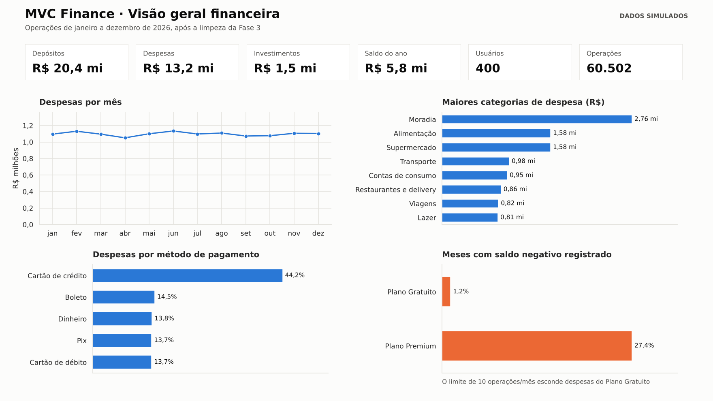
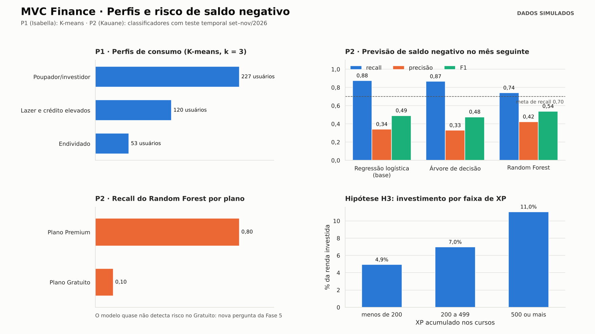
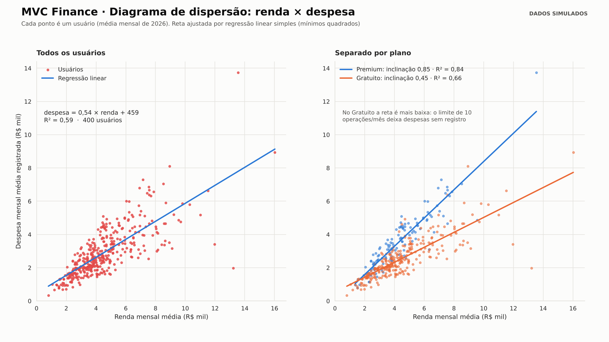

# MVC Finance – Análise de Dados com CRISP-DM

[](https://colab.research.google.com/github/SEU-USUARIO/MVCFinance-CRISP-DM-Analysis/blob/main/notebooks/pratica_crispdm_mvc_finance.ipynb)

Parte prática do trabalho de **Ciência de Dados e Aprendizagem de Máquina (A1)**, com a Profa. Kadidja Valéria, no Centro Universitário do Distrito Federal (UDF). O projeto aplica as seis fases do **CRISP-DM** ao **MVC Finance**, aplicativo web de gestão financeira pessoal desenvolvido no nosso TCC. O objetivo é recomendar cursos de educação financeira com base nos gastos de cada usuário e prever o risco de o mês terminar com saldo negativo.

O repositório reúne uma análise em **SQL** (validações de qualidade e KPIs), um **notebook em Python** com um diagrama de dispersão com regressão linear e a modelagem (K-means e classificadores), além de um **dashboard** de três páginas feito em Python (Pandas, Matplotlib e Seaborn) no lugar do Power BI.

> **Dados simulados.** O MVC Finance ainda não tem usuários reais. A base foi gerada pelo notebook com a mesma estrutura do banco do sistema (`Usuario`, `Operacao`, `TipoOperacao`, `Categoria`, `MetodoPagamento`) e com as suas regras de negócio, incluindo o limite de 10 operações por mês no Plano Gratuito. Também foram inseridos erros de propósito. Os números demonstram o método e **não são resultados do sistema em produção**. Os nomes das 28 categorias são ilustrativos e seguem a divisão do TCC: 15 de despesa, 7 de depósito e 6 de investimento.

## Perguntas de análise

| Pergunta | Responsável | Técnica | Resposta (dados simulados) |
|---|---|---|---|
| **P1.** Quais perfis de consumo existem entre os usuários e qual curso recomendar a cada um? | Isabella Ana Dutra de Sousa | K-means e regras "perfil → curso" | 3 perfis (Poupador/investidor, Lazer e crédito elevados, Endividado), silhueta 0,34 |
| **P2.** É possível prever se o usuário terminará o mês seguinte com saldo negativo? | Kauane Braga dos Santos Silva de Sousa | Regressão logística, árvore de decisão e Random Forest | Sim no Premium (recall 0,80); no Gratuito o recall cai para 0,10 por causa do limite de 10 operações |

## Dados

Base bruta em `mvc_finance_data/`, de 1 jan. a 31 dez. 2026, com 25 operações datadas de 2027 (erro proposital).

| Tabela | Linhas | Conteúdo |
|---|---:|---|
| `operacao` | 60.527 | Cada lançamento: usuário, data, valor, tipo, categoria e método de pagamento |
| `usuario` | 400 | Usuário (e-mail fictício), plano, XP total e cursos concluídos |
| `categoria` | 28 | Categorias e o tipo de operação a que pertencem |
| `metodo_pagamento` | 6 | Cartão de crédito, cartão de débito, Pix, boleto, dinheiro e transferência |
| `tipo_operacao` | 3 | Depósito, Despesa e Investimento |

Tabelas geradas pelo notebook em `mvc_finance_data/processed/`: `usuario_mes` (tabela analítica, 4.549 linhas × 33 colunas), `regressao_dispersao`, `perfis_kmeans`, `metricas_modelos`, `recall_por_plano` e `saida_job_mensal` (perfil, curso recomendado e alerta de cada usuário).

**Termos usados:**
- **Operação:** um lançamento (uma linha de `operacao`).
- **Usuário-mês:** o conjunto das operações de um usuário em um mês. É a unidade de análise.
- **Saldo do mês:** depósitos − investimentos − despesas (regra RN-D02 do TCC).

## Principais resultados

| Resultado | Valor | Fonte |
|---|---|---|
| Operações com data futura | 25 (removidas) | SQL V3 |
| Despesas lançadas em categoria de depósito | 605 | SQL V4 |
| Prováveis erros de digitação (valor > 10× a mediana do usuário na categoria) | 226 | SQL V5 |
| Usuário-meses do Gratuito que bateram o limite de 10 operações | 3.142 (99,1%) | SQL V6 |
| Depósitos / despesas / investimentos no ano | R$ 20,4 mi / R$ 13,2 mi / R$ 1,5 mi | SQL KPI 1 |
| Maior categoria de despesa | Moradia (21,0% das despesas) | SQL KPI 3 |
| Participação do cartão de crédito nas despesas | 44,2% | SQL KPI 4 |
| Meses com saldo negativo registrado: Gratuito × Premium | 1,2% × 27,4% | SQL KPI 6 |
| Renda investida: menos de 200 XP × 500 XP ou mais | 4,9% × 11,0% | SQL consulta B |
| Regressão linear despesa × renda (todos os usuários) | despesa = 0,54 × renda + 459 · R² = 0,59 | Notebook, seção 3.5 |
| Inclinação da reta: Premium × Gratuito | 0,85 (R² 0,84) × 0,45 (R² 0,66) | Notebook, seção 3.5 |
| Perfis de consumo (K-means, k = 3, silhueta 0,34) | Poupador/investidor 227 · Lazer e crédito 120 · Endividado 53 | Notebook, Fase 4 |
| Melhor modelo para saldo negativo (Random Forest) | Recall 0,74 · Precisão 0,42 · F1 0,54 · AUC 0,90 | Notebook, Fase 4 |
| Recall do Random Forest: Gratuito × Premium | 0,10 × 0,80 | Notebook, Fase 5 |
| Usuários que receberiam alerta em jan./2027 | 70 de 400 | Notebook, Fase 6 |

**Observações:**
- **O limite do Plano Gratuito distorce os dados.** 99% dos meses do Gratuito chegam ao teto de 10 operações, as despesas menores ficam sem registro e só 1,2% dos meses aparecem negativos, contra 27,4% no Premium. O diagrama de dispersão mostra o mesmo efeito: no Premium, cada R$ 1 de renda vem com R$ 0,85 de despesa; no Gratuito, só R$ 0,45. Por isso o alerta quase não funciona para o Gratuito (recall 0,10). Esta é a "nova pergunta" que a avaliação revela, e ela leva de volta às fases 2 e 3.
- **A limpeza também passou por uma iteração.** A primeira regra de erro de digitação comparava cada valor com a mediana geral da categoria e "corrigia" investimentos legítimos de quem investe muito. Comparar com o histórico do próprio usuário resolveu.
- **Os quatro critérios técnicos foram atingidos:** silhueta > 0,25, menor cluster ≥ 5%, recall ≥ 0,70 e F1 acima do modelo base. A regressão logística ficou muito próxima do Random Forest (AUC de 0,90 nos dois) e é mais simples de explicar.
- **O K-means juntou os perfis "essencial" e "poupador"**, e o teste com k = 4 não os separou. A próxima iteração seria reduzir os atributos de categoria ou dar mais peso à taxa de investimento.
- **Na base simulada, quem tem mais XP investe uma fração maior da renda** (hipótese H3). Correlação não é causalidade: isso precisa ser testado com usuários reais.

## SQL

`mvc_finance.sql` (PostgreSQL, o mesmo banco do MVC Finance) contém:
- **Tabelas:** criação das 5 tabelas e comandos `\copy` para carregar os CSVs.
- **V1–V6:** validações de qualidade da base bruta (nulos, valores não positivos, datas futuras, categoria incoerente com o tipo, prováveis erros de digitação, limite do Plano Gratuito).
- **`operacao_limpa`:** view com a base limpa (Fase 3).
- **KPI 1–KPI 7:** totais, operações por plano, categorias, métodos de pagamento, despesas por mês, saldo negativo e despesa registrada por plano.
- **Consultas de apoio A e B:** tabela analítica usuário-mês e taxa de investimento por faixa de XP.

Para conferir sem instalar o PostgreSQL: `python scripts/rodar_sql_duckdb.py` executa o arquivo inteiro no DuckDB.

`MVC_Finance_Analysis.pdf` (18 páginas) traz uma capa e uma consulta por página, com o SQL colorido e o resultado logo abaixo (V1–V6, view, KPI 1–7, A e B), gerado por `python scripts/gerar_pdf_consultas.py`.

## Notebook

`notebooks/pratica_crispdm_mvc_finance.ipynb` percorre as seis fases do CRISP-DM:

| Fase | O que o notebook faz |
|---|---|
| 1. Entendimento do negócio | Resume objetivos, metas técnicas e critérios de sucesso |
| 2. Entendimento dos dados | Gera a base, descreve volume e tipos, explora gráficos e verifica a qualidade |
| 3. Preparação dos dados | Pseudonimiza o e-mail, limpa os erros, constrói a tabela usuário-mês e traça o diagrama de dispersão renda × despesa com regressão linear |
| 4. Modelagem | K-means (k de 3 a 6) e regressão logística, árvore de decisão e Random Forest, com teste temporal |
| 5. Avaliação | Confronta com os critérios, itera o K-means e compara o desempenho por plano |
| 6. Implementação | Protótipo do job mensal (perfil, curso recomendado e alerta), monitoramento de drift e dashboard em Seaborn |

O notebook é autossuficiente: gera a própria base e roda direto no Colab pelo botão no topo desta página (**Ambiente de execução → Executar tudo**).

## Dashboard

O dashboard foi feito em Python no lugar do Power BI, com as bibliotecas de visualização da disciplina: **Pandas** agrega os dados, **Seaborn** desenha os gráficos (`barplot`, `lineplot` e `regplot`) e **Matplotlib** monta as páginas. Ele é gerado pelo próprio notebook, na seção "Dashboard", e salvo em `Dashboard/`. Tem três páginas.

**Página 1 – Visão geral financeira:** indicadores do ano, despesas por mês, maiores categorias, métodos de pagamento e meses com saldo negativo por plano.



**Página 2 – Perfis e risco de saldo negativo:** perfis do K-means, métricas dos classificadores, recall por plano e hipótese H3.



**Página 3 – Diagrama de dispersão:** renda × despesa mensal média de cada usuário, com reta de regressão linear, para todos os usuários e separado por plano.



Para gerar as imagens de novo, basta executar o notebook.

## Como executar localmente

```bash
pip install -r requirements.txt
jupyter nbconvert --to notebook --execute notebooks/pratica_crispdm_mvc_finance.ipynb   # gera mvc_finance_data/ e Dashboard/
python scripts/rodar_sql_duckdb.py                                                     # validações e KPIs
python scripts/gerar_pdf_consultas.py                                                  # PDF das consultas
```

## Estrutura

```
├── Dashboard/                 páginas do dashboard (PNG), geradas pelo notebook com Seaborn
├── mvc_finance_data/          base simulada (CSV)
│   └── processed/             tabelas geradas pelo notebook
├── notebooks/                 notebook CRISP-DM (abre no Colab)
├── scripts/                   SQL no DuckDB e PDF das consultas
├── mvc_finance.sql            validações, view da base limpa, KPIs e consultas de apoio
├── MVC_Finance_Analysis.pdf   consultas com os resultados
├── requirements.txt
└── README.md
```

## Ferramentas

- PostgreSQL / DuckDB (SQL)
- Pandas e NumPy (preparação dos dados)
- Matplotlib e Seaborn (visualização e dashboard, no lugar do Power BI)
- scikit-learn (K-means, regressão linear e classificadores)
- Playwright (PDF das consultas)
- Jupyter / Google Colab

## Autores

- Isabella Ana Dutra de Sousa – Pergunta 1 (perfis de consumo e recomendação de cursos)
- Kauane Braga dos Santos Silva de Sousa – Pergunta 2 (previsão de saldo negativo)

## Sobre

Projeto-base: TCC *MVC Finance: aplicativo web de gestão financeira pessoal* (UDF, 2026). Metodologia: CRISP-DM (Chapman et al., 2000), seguindo o guia da disciplina.

`crisp-dm` `data-science` `machine-learning` `sql` `postgresql` `python` `scikit-learn` `k-means` `random-forest` `financas-pessoais`
